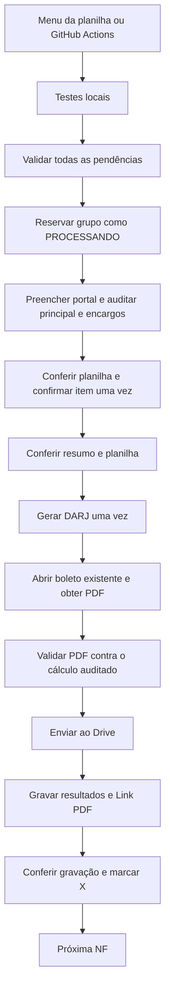

# Documentação funcional e técnica — RPA DARJ-RJ

Referência: código do ZIP revisado em **05/11/2026**. Para instalação e operação rápida, consulte [README.md](README.md).

## Objetivo e responsabilidades

O projeto automatiza a emissão de guias DARJ para o contribuinte configurado. Ele lê os principais na planilha, confere o formulário e os encargos calculados pelo portal, valida o documento gerado e registra o resultado.

| Parte | Responsabilidade |
|---|---|
| Operador | Importar notas reais consolidadas, conferir ST/FCP, histórico e duplicidades e investigar emissões incertas |
| Google Sheets | Guardar relatório de origem, principais, status e resultados; o modelo antigo mantém alíquotas/subtotais |
| Apps Script | Criar o menu e pedir ao GitHub que inicie o workflow |
| GitHub Actions | Preparar a execução no runner, executar testes/validação/emissão e preservar artefatos |
| Python/Selenium | Preencher o portal, conferir as respostas e obter o PDF |
| Portal RJ | Calcular os valores finais e gerar o documento |
| Google Drive | Armazenar o PDF enviado pelo robô |

O projeto emite documentos. **Não efetua pagamento bancário, não debita conta e não comprova quitação.** A data de pagamento preenchida no portal é um parâmetro da guia.

## Visão do fluxo



Qualquer falha interrompe o lote. A confirmação do item e a geração não são repetidas automaticamente. A pausa padrão entre guias concluídas é de cinco segundos.

## Estrutura e arquivos

| Arquivo/pasta | Função |
|---|---|
| `bot.py` | Portal, Selenium, integrações Google, download, diagnóstico e entrada do programa |
| `controle_darj.py` | Leitura lógica, agrupamento, regras de datas, dinheiro, encargos, PDF e transições de status |
| `AppsScript_RJ.gs` | Menu do Google Sheets e solicitação de workflow |
| `requirements.txt` | Versões fixadas das dependências Python |
| `credenciais.example.json` | Modelo de credencial, sem substituir a chave real |
| `testar_acesso.py` | Conferência básica de acesso Google; usa IDs próprios, primeira aba e linha 1 |
| `.github/workflows/darj-rj.yml` | Workflow principal de validação e emissão |
| `.github/workflows/diagnosticar-espaco-rj.yml` | Medição de disco, inodes, caches e navegadores; não apaga arquivos |
| `.gitignore` | Exclui credenciais reais e saídas operacionais, ambiente virtual e caches listados |
| `tests/` | Testes de cálculo, planilha, fluxo, PDF, Selenium simulado e Apps Script |
| `diagnosticos/` | Capturas e dados do navegador quando disponíveis |
| `downloads_darj/` | Subpastas de download por tentativa/NF |
| `.darj-rj.lock` | Arquivo utilizado pelo bloqueio de processo na mesma pasta |
| `aplicar_encargos_v3.py` | Aplicador temporário da revisão de encargos; não participa da emissão |
| `.backup_encargos_.../` | Backup anterior à aplicação; não é código ativo |

Nenhum passo do workflow executa o aplicador. Não é preciso mantê-lo como dependência do RPA. Os arquivos de backup não substituem o versionamento do código atual.

## Entradas da planilha

O padrão é a aba **Entrada RJ**, definida por `ABA_CONTROLE`. A seleção exige essa aba e cabeçalhos válidos. Se a aba estiver ausente ou inválida, para sem buscar uma alternativa. Para usar outra aba, configure ABA_CONTROLE explicitamente.

`localizar_cabecalho()` confere as linhas 1, 2 e a linha preferida recebida. No bot atual a referência LINHA_CABECALHO é 2, portanto a seleção reconhece as linhas 1/2. Se ambas parecerem cabeçalhos, há bloqueio por ambiguidade. Os números reais das linhas são preservados nas atualizações.

`resolver_colunas()` detecta o relatório direto pela presença dos nomes Valor ST, Valor FCP, N.Fiscal ou Doc MIRO e então exige o esquema completo abaixo. Cabeçalhos ausentes/duplicados e mistura com o modelo antigo bloqueiam. A comparação normaliza acentos e caixa, mas não adivinha nomes abreviados diferentes.

### Relatório direto: esquema de entrada

| Campo interno | Cabeçalho de origem | Tratamento |
|---|---|---|
| miro | Doc MIRO | Número positivo; identidade normalizada para detectar duplicidade |
| tipo | Tipo | Deve ser compra; outros tipos param para conferência |
| nota | N.Fiscal | NF e série, preservadas no portal/PDF |
| data | Data Lanc | Entrada, período e referência para as regras de vencimento |
| centro | Centro | Obrigatório; participa da identidade da NF e do prefixo do arquivo |
| icms | Valor ST | Principal de ICMS, sem incluir FCP |
| fecp | Valor FCP | Principal de FECP |
| total | Sem coluna de origem | Calculado pelo Python: ST + FCP |

Os cinco cabeçalhos de resultado são obrigatórios: PROC DARJ, Nº DARJ, Vcto DARJ, Valor DARJ e Link DARJ. Na disposição dos anexos, as 18 colunas de origem ficam em A:R e as cinco de resultado em S:W. O backend localiza todas por nome, permitindo reordenar colunas.

As demais colunas — Data Fatur, Fornecedor, Nome, Região, Montante, Nº pedido, Texto, Usuário, Doc Contab, Doc Materi e FUNEF — são metadados e não alteram o principal nem as datas usadas na guia. O Python não deriva ST a partir de Montante nem da nota bruta. O CNPJ do contribuinte continua fixo no bot, independente do Centro/Fornecedor.

Datas aceitas: DD.MM.AAAA, DD/MM/AAAA e AAAA-MM-DD. Data Lanc futura ou ano menor que 1900 bloqueiam pendências. A data de faturamento não substitui uma Data Lanc ausente/inválida.

### Cálculo do principal sem fórmulas

```text
principal ICMS = Valor ST
principal FECP = Valor FCP
principal total = Valor ST + Valor FCP
```

Exemplo confirmado: ST 173,35 e FCP 20,07 geram principal 193,42. Com Data Fatur 28/10/2026 e Data Lanc 03/11/2026, a referência é **11/2026**.

Outros exemplos dos anexos: 2.809,82 + 245,72 = 3.055,54 e 1.417,24 + 128,14 = 1.545,38.

O parser dinheiro() usa Decimal. Valores precisam ser finitos, não negativos e válidos em centavos; o total deve ser positivo. FCP zero é permitido, mas precisa vir preenchido. Campo vazio, erro de fórmula ou fração de centavo não viram zero. O código não arredonda silenciosamente nem aplica tolerância para aceitar divergências.

Vlr Produtos, IPI, ICMS Normal, ALQ ICMS, BC da ST e ST calculado do modelo antigo não são necessários no relatório direto. Não há cálculo de MVA/base/percentuais fiscais pelo backend. O script separado de correção de arredondamento do modelo antigo também não é requisito da aba nova.

### NF consolidada e proteção por Doc MIRO

No relatório direto, cada linha deve representar uma NF consolidada. O backend não soma duas ocorrências da mesma NF sem informação de alíquota: bloqueia para conferência, mesmo que tenham documentos MIRO diferentes.

A identidade de NF considera número/série, Centro e período. Séries diferentes são notas distintas; zeros à esquerda são normalizados para detectar duplicidades, mantendo o texto original no documento.

`conferir_documentos_miro()` compara Doc MIRO normalizado e ano da Data Lanc. Uma ocorrência repetida envolvendo pendência ou PROCESSANDO bloqueia; a conferência ocorre no planejamento e nas releituras. Isso evita que um mesmo documento seja importado sob NFs diferentes e que uma duplicidade inserida durante a execução passe despercebida.

O retrato de entrada inclui Data Lanc, NF, Centro, principais, total derivado, Doc MIRO e Tipo. Mudanças nesses dados durante o processamento interrompem a execução. Outros metadados não participam dessa comparação.

### Compatibilidade com o modelo antigo

O modo antigo continua aceitando Data entrada, Nº Nota Fiscal, DARJ Normal, FECP e TOTAL DA GUIA DE ICMS ST, junto aos cinco campos de resultado. Nele, Centro é opcional e ALQ ICMS precisa existir nas parcelas agrupadas.

Somente nesse modo, linhas consecutivas da mesma NF/Centro com alíquotas diferentes são somadas para emitir uma guia. Continuação com data vazia herda a primeira; datas explícitas precisam coincidir. SOMA VALORES, quando presente, precisa coincidir com os principais somados e não é contado novamente. Alíquota repetida, grupo parcialmente marcado ou NF em blocos separados bloqueiam.

No modelo antigo as fórmulas precisam produzir centavos consistentes; formatar duas casas não arredonda o valor armazenado. O total da linha é conferido contra DARJ Normal + FECP. Não misture os dois esquemas na mesma aba.

### Migração e histórico

O código lê e controla a aba selecionada, sem cruzar automaticamente guias de abas históricas. Antes de importar o relatório com status vazio, confira se as NFs já foram emitidas no modelo antigo. Preserve os status e resultados reais dessas guias na nova aba ou importe somente pendências verificadas. Não copie linhas emitidas como novas pendências.

A mudança de Data entrada para Data Lanc também pode mudar o mês de referência: confira esse efeito ao migrar registros antigos. O sistema não faz migração automática do histórico.

## Regras de datas

`hoje` é calculado no fuso `America/Sao_Paulo`. No relatório direto, **Data Lanc** determina a entrada e o período de referência, independentemente da Data Fatur e do mês da execução. No modelo antigo a origem é Data entrada. Não há filtro obrigatório por D-1.

### Mês da entrada já encerrado

Se o mês/ano da entrada é anterior ao da execução:

```text
pagamento = hoje
vencimento = último dia corrido do mês da entrada
```

Nesse ramo, o vencimento não é ajustado para dia útil. Exemplo: entrada `30/10/2026`, execução `03/11/2026`: pagamento `03/11`, vencimento `31/10`, referência `10/2026`.

### Mês ainda corrente

Primeiro calcula-se execução + **dois dias corridos**. Se cair em sábado, domingo ou feriado configurado, avança até um dia útil. Se o pagamento ainda estiver no mês da entrada, pagamento e vencimento são iguais.

Se ultrapassar o mês, calcula-se o último dia útil do mês da entrada. Enquanto esse limite for igual ou posterior ao dia da execução, o pagamento é antecipado para esse limite e o vencimento recebe a mesma data.

Exemplo: entrada `28/10/2026`, execução `29/10/2026`: D+2 ajustado chegaria a `03/11`; pagamento e vencimento são antecipados para `30/10`.

### Execução após o último dia útil, mas ainda no mesmo mês

O código mantém uma exceção explícita: quando o último dia útil calculado já é anterior a `hoje`, o vencimento fica em `hoje`, enquanto o pagamento permanece D+2 ajustado. Exemplo de execução em `31/10/2026`: vencimento `31/10` e pagamento `03/11`, considerando o feriado configurado de `02/11`.

Esse caso pode produzir encargos, que seguem a mesma auditoria. Ele é diferente de uma execução já em novembro, tratada pelo primeiro ramo.

### Exemplo do relatório direto

Para Data Lanc 03/11/2026, executando em 05/11/2026: a referência é 11/2026; D+2 cai no sábado 07/11 e avança para segunda 09/11. Pagamento e vencimento ficam em 09/11, conforme o calendário configurado. D+2 parte da execução, não da Data Lanc.

### Calendário

O `main()` cria `holidays.Brazil(subdiv='RJ')` para o ano da execução, anterior e seguinte. Não há calendário municipal separado nem sincronização com as regras internas do portal. Datas e valores finais são conferidos no formulário e no PDF; esta documentação descreve a implementação, não estabelece prazo tributário legal.

## Encargos e total final

Os objetos mantêm duas informações separadas:

| Objeto | Conteúdo |
|---|---|
| `Alvo` | NF, Centro, entrada, principais, datas e retrato das linhas/subtotal |
| `CalculoPortal` | Principais observados, mora, multa e totais de ICMS/FECP |
| `EmissaoPortal` | Caminho do PDF e cálculo auditado que originou a emissão |

As igualdades exigidas são:

```text
ICMS informado = ICMS da planilha
FECP informado = FECP da planilha
ICMS atualizado = ICMS da planilha
FECP atualizado = FECP da planilha

Total ICMS = ICMS + Mora ICMS + Multa ICMS
Total FECP = FECP + Mora FECP + Multa FECP
Total final = Total ICMS + Total FECP
Total final = Principal total + todos os encargos
```

Todos os campos precisam estar presentes e válidos, inclusive campos com valor zero. Encargos positivos exigem pagamento posterior ao vencimento. Correção monetária que altere os campos de principal atualizado fica bloqueada para conferência manual.

Os valores de mora e multa vêm do portal. O robô verifica sua composição, mas não recalcula as taxas fiscais de forma independente.

Caso observado: `1.953,44 + 19,53 + 6,45 = 1.979,42` de ICMS e `214,49 + 2,14 + 0,71 = 217,34` de FECP. Total **2.196,76**. Esse valor passa pelo resumo, pela tela de DARJ emitido, pela validação do PDF e pela gravação em `Valor DARJ`.

Nunca se escolhe o total esperado a partir do próprio PDF: ele deve coincidir com o cálculo auditado antes da geração. Retornos antigos que fornecem apenas um caminho de arquivo continuam restritos ao principal, sem aceitar encargos.

## O que cada função faz

### Controle de dados — controle_darj.py

| Função | Responsabilidade |
|---|---|
| `normalizar` | Remove acentos e diferenças de caixa para comparar textos |
| `resolver_colunas` | Distingue relatório direto/modelo antigo; rejeita mistura, ausência e duplicidade de cabeçalhos |
| `registro_da_linha` | Converte a linha e calcula ST + FCP em Decimal no relatório direto |
| `localizar_cabecalho` | Localiza o cabeçalho válido e rejeita ambiguidade |
| `conferir_documentos_miro` | Bloqueia Doc MIRO duplicado no ano da Data Lanc envolvendo pendência/PROCESSANDO |
| `ler_registros` | Preserva os números reais das linhas e monta os registros |
| `dinheiro` | Converte e valida moeda em `Decimal` |
| `brl` | Formata valor com vírgula e duas casas para campos/logs |
| `parse_data` | Interpreta os formatos de data aceitos |
| `dia_util` | Confere fim de semana e conjunto de feriados recebido |
| `calcular_datas` | Aplica D+2, fechamento e mês encerrado |
| `preparar_alvo` | Valida NF, dinheiro e entrada; no modo direto também exige MIRO, compra e Centro |
| `conferir_calculo_portal` | Lê os campos monetários observados e valida sua composição |
| `total_esperado` | Retorna o total final auditado ou o principal no contrato legado |
| `extrair_dados_pdf` | Confere identidade, número, datas e total extraídos do documento |
| `validar_pdf` | Verifica o arquivo, extrai texto com layout, valida e renomeia |
| `tipo_linha_estrutural` | Reconhece modelo vazio/zerado ou rodapé Total |
| `identidade_nota` | Compara número/série normalizando zeros à esquerda |
| `separar_blocos` | Forma grupos consecutivos e associa subtotais |
| `chave_bloco` | Identifica NF/série, Centro e período para detectar blocos repetidos |
| `ler_aliquota` | Normaliza a alíquota para distinguir parcelas |
| `preparar_grupo` | No modelo antigo valida/soma parcelas; no direto exige uma linha de NF consolidada |
| `planejar_lote` | Valida a seleção inteira antes de iniciar emissões |
| `endereco_celula` | Converte número de coluna/linha em endereço como `O97` |
| `executar_lote` | Reserva grupos, chama emissão, valida PDF, envia e confirma resultados/status |

Classes auxiliares: `BlocoNF` representa as parcelas e o subtotal; `Alvo` é a entrada consolidada. `CalculoPortal.validar()` implementa a composição monetária; suas propriedades `total` e `encargos` separam final e acréscimos. As estruturas são dataclasses imutáveis; alterações de grupo usam cópias controladas.

### Portal e navegador — bot.py

| Função | Responsabilidade |
|---|---|
| `verificar_mensagens` | Detecta alertas e diálogos do portal; não os aceita automaticamente |
| `esperar` | Executa esperas verificando mensagens e tolerando elementos temporariamente desatualizados |
| `esperar_elemento` | Aguarda um campo clicável por ID |
| `preencher` | Preenche campo editável, dispara blur e aguarda requisições |
| `aguardar_ajax` | Aguarda documento carregado e requisições jQuery/DWR pendentes terminarem |
| `confirmar_data_pagamento` | Altera e confirma a data pelo fluxo do portal e verifica a confirmação |
| `selecionar` | Aguarda a opção e seleciona o valor de uma lista |
| `criar_driver` | Configura Chrome, download, modo sem janela e tempos de espera |
| `dump_debug` | Salva contexto, campos, HTML e capturas das abas disponíveis |
| `preencher_periodo` | Define MM/AAAA completo antes de disparar a validação original do portal |
| `preencher_formulario` | Abre o portal, identifica contribuinte, preenche datas/NF/principais e retorna o cálculo auditado |
| `auditar_formulario` | Confere composição monetária, datas, referência, NF, natureza e produto |
| `botao_gerar_unico` | Exige uma identificação não ambígua do botão Gerar DARJ |
| `auditar_resumo` | Confere quantidade de documentos e total final antes de gerar |
| `abrir_darj_emitido` | Confere tela de emissão, CNPJ, quantidade e total e abre o boleto existente |
| `aguardar_pdf` | Aguarda download estável ou valida HTML imprimível antes de gerar PDF local |
| `emitir_portal` | Coordena uma tentativa única por grupo e retorna arquivo com o cálculo auditado |
| `selecionar_aba` | Exige a aba configurada, com cabeçalho válido; não usa outra aba como fallback |
| `exclusao_local` | Impede dois processos simultâneos na mesma pasta |
| `main` | Lê argumentos/configurações, inicializa Google/calendário e chama o lote |

Funções internas relevantes: `subir_pdf`, no `main`, cria o arquivo no Drive e exige ID de retorno. `ler_atual`, dentro de `executar_lote`, confere novamente grupo/colunas/entradas/status/resultados. `antes_envio` faz a releitura e registra o ponto de possível envio antes do clique.

O contribuinte é fixo em `CNPJ_RESPONSAVEL`. O preenchimento seleciona natureza `4`, produto `442` e período mensal `M`. Centro não troca essas seleções. Não há CAPTCHA resolvido automaticamente nem tentativa de contornar bloqueios do portal.

## PDF, nome e Drive

O download é separado em `downloads_darj/linha_<linha>_<id>/`. O navegador usa download automático de PDFs. A espera exige um único PDF novo, tamanho estável e ausência de arquivos parciais reconhecidos.

Quando a resposta é HTML imprimível, o fallback exige conteúdo compatível com a NF, CNPJ, datas e total esperado e evidência de código de barras/linha digitável, além de imagens carregadas. A impressão local não solicita uma nova guia.

A validação exige:

- Cabeçalho de arquivo `%PDF-`, leitura estrita e documento não criptografado.
- Identificação DARJ, CNPJ esperado e NF/série nas informações extraídas.
- Número de guia único entre as ocorrências identificadas; `Nosso Numero`, quando presente, exige 25 dígitos. Existe fallback para outros rótulos do documento.
- Vencimento esperado e pagamento/validade quando identificados no documento.
- Total único e igual ao valor auditado, inclusive quando há várias vias/DIP. Totais distintos sob os rótulos analisados ficam bloqueados.

O código não faz OCR, não verifica autenticidade por assinatura digital e não recalcula o dígito verificador do código de barras. A conferência do PDF usa texto extraído e os campos definidos no parser.

O código atual distingue o layout no nome:

```python
prefixo = re.sub(r'[^\w-]', '_', alvo.centro) + '_' if alvo.centro else ''
marcador = '' if 'miro' in alvo.origem else 'CE12_'
nome = f"{prefixo}{marcador}DARJ_NF_{alvo.nota_raw}.pdf"
```

No relatório direto, Centro CE12 e NF 652063-7 produzem **CE12_DARJ_NF_652063-7.pdf**, sem duplicar CE12. No modelo antigo, o marcador CE12_ fixo é preservado após o prefixo opcional. A série permanece em ambos; o número do DARJ fica na planilha, não no nome.

Se outro arquivo já existir com o nome final na pasta local, há bloqueio em vez de sobrescrita. Os downloads são separados por tentativa, mas isso não deve ser usado como autorização para reemitir a mesma guia.

Depois da validação, o upload cria um arquivo na pasta configurada com `supportsAllDrives=True`. Só após receber ID válido o controle grava resultados, verifica a fórmula/destino de `Link PDF` e marca `X`. Nenhuma permissão pública é criada pelo upload.

**Somente no modelo antigo**, grupos com parcelas repetem número, vencimento, total final, link e status em todas as parcelas. No relatório direto há uma linha por NF. Para relatórios, deduplique por guia: somar `Valor DARJ` de todas as parcelas duplicaria valores. O subtotal permanece como entrada conferida e não recebe esses resultados.

## Status, concorrência e recuperação

O grupo é reservado como `PROCESSANDO` antes de abrir o portal. Após a confirmação de PDF, upload e gravações, recebe `X`. Se o controle ainda não registrou possível envio, falhas recebem `ERRO`; a partir da tentativa de confirmar item, recebem `REVISAR`.

O marcador de envio é conservador: `REVISAR` não prova que a guia existe, mas exige conferir essa possibilidade. Antes de alterar status após uma falha, o controle tenta confirmar que a linha ainda pertence à mesma NF/Centro.

O programa relê a planilha para detectar mudanças de cabeçalhos, entradas, Doc MIRO/Tipo no modo direto, linhas do grupo, subtotal no modo antigo, ocorrências duplicadas, status e resultados. O número da guia é escrito como texto via `RAW`; o link é escrito como fórmula via `USER_ENTERED` e conferido pelo destino, não só pelo rótulo.

A concorrência do workflow e o arquivo `.darj-rj.lock` evitam sobreposição no mesmo contexto. Não são um bloqueio distribuído de todas as máquinas que possam acessar a planilha.

## Recuperação de falhas

1. Identifique a execução, NF, linhas e etapa que falhou. Confira se o passo era teste, validação ou emissão.
2. Baixe o artefato e localize o `contexto.json` pela hora da execução. O artefato pode conter arquivos antigos preservados no runner.
3. Se a falha foi em testes ou `--validar`, não houve emissão pelo passo do lote nessa execução.
4. Se houver `REVISAR`, PDF local, número ou link existente, confira a guia antes de pensar em liberar a linha. Não faça outra geração para tentar recuperar o upload.
5. Em `ERRO`, investigue a causa e o histórico da NF. Corrija dados/código antes de remover o status; não libere um grupo parcialmente processado.
6. Uma nova execução ignora os grupos já marcados. Não há comando implementado para reenviar automaticamente um PDF existente ao Drive ou reconciliar uma emissão incerta.

| Erro | Interpretação/ação |
|---|---|
| Soma da linha/subtotal divergente | Conferir principais e arredondamento; não aumentar o principal para absorver multa |
| Doc MIRO repetido | Conferir o relatório e as guias já emitidas; não trocar o identificador para liberar |
| NF repetida no relatório direto | Conferir consolidação/duplicidade; não somar automaticamente cópias |
| Layout misturado | Separar relatório direto e modelo antigo em abas distintas |
| Aba ausente/inválida | Conferir ABA_CONTROLE, nome da aba e cabeçalhos nas linhas 1/2 |
| NF em blocos separados | Conferir duplicidade ou parcelas legítimas; não remover a proteção nem somar cópias da mesma parcela |
| Auditoria bloqueada | Ler os campos observados: principal, atualizado, mora, multa, totais e datas |
| Principal atualizado diferente | Correção monetária fora do tratamento automático atual; conferir manualmente |
| Período inválido | Conferir data de entrada, ano e MM/AAAA observado no portal |
| PDF/identificador divergente | Preservar documento e status; pode haver emissão já concluída no portal |
| PDF final já existe | Conferir nome, série e arquivo existente; não sobrescrever para forçar o teste |
| Falha no Drive | Conferir arquivo local, credencial, destino e permissões; não reemitir |
| Lote sem pendências | Nenhuma linha elegível; não é uma emissão nova nem um novo upload |
| Falta de pypdf | Instalar requirements no mesmo interpretador usado nos testes |
| ENOSPC | Medir disco/inodes/cache; preservar documentos pendentes de revisão |
| 403 no menu | Conferir acesso e permissão do token do GitHub, não a credencial Google |

## Workflows e infraestrutura

### darj-rj.yml

O fluxo principal é manual (`workflow_dispatch`), sem input de linha. O bloco `schedule` está comentado. As linhas `# if: ...` junto dos passos de validação/emissão são comentários, portanto a emissão está habilitada após as etapas anteriores passarem. Não basta o job ficar verde: confira se a etapa de emissão realmente executou e se havia pendências.

Sequência: checkout com `clean: false` e credencial Git não persistida; instalação de dependências; verificação do Chrome/limpeza restrita do cache antigo; testes Python; recuperação da chave Google; `--validar`; emissão; upload de artefatos e remoção da chave temporária.

O job usa runner `self-hosted`, tempo máximo de 120 minutos, fuso de São Paulo, navegador headless e logs Python sem buffer. A concorrência é `emissao-darj-rj`, sem cancelar uma emissão em andamento.

O passo de navegador exige `/usr/bin/google-chrome` existente e funcional. O cache a limpar é `/home/ghrunner/actions-runner/_work/_tool/setup-chrome/chromium`. O código confere correspondência com `RUNNER_TOOL_CACHE`, resolução de caminho, ausência de symlink, independência do Chrome instalado e ausência de processo usando aquele cache. Uma migração exige revisar esses caminhos; não copie a limpeza para outra pasta sem conferir.

O navegador tem espera de carregamento de página de 60 segundos e espera Selenium de 45 segundos. O download tem limite padrão de 90 segundos. Esses limites não autorizam repetir o clique de geração.

Artefatos usam retenção de três dias. A retenção no GitHub não limpa o disco local do runner; `clean: false` pode acumular diagnósticos e PDFs. O workflow de espaço auxilia a medição, sem apagar arquivos. Não há checagem de IP fixo no código; `self-hosted` é a configuração atual de execução, não prova uma exigência geral do portal.

### Credenciais e menu

A conta de serviço Google é carregada de `credenciais.json`. O workflow a reconstrói do secret `GOOGLE_CREDENTIALS_B64` com permissões restritas e tenta remover o arquivo com `if: always()`.

O Apps Script usa outro segredo: `GITHUB_TOKEN_RJ`, guardado nas propriedades do script. `onOpen()` chama `adicionarMenuDARJRJ()`. `dispararRoboDARJRJ()` lê o token, solicita o dispatch com `{ref: 'main'}` e informa o resultado HTTP. Não preenche valores, não calcula datas e não emite a guia por conta própria.

HTTP 200/204 é aceito pelo script como solicitação bem-sucedida. Há mensagens específicas para 401, 403, 404 e 422. Em resposta incerta de rede, ele orienta conferir o GitHub antes de repetir. O token não deve ser escrito literalmente no `.gs`.

`testar_acesso.py` apenas confere leitura básica e metadados da pasta. Sua descrição diz que pode rodar antes do bot, mas o workflow principal não o chama. Ele usa `sheet1` e linha 1, diferente da seleção real do bot, e não testa criação de arquivo no Drive.

## Testes e manutenção

Na revisão local do ZIP, passaram **148 testes Python e nove cenários do Apps Script**. Todos usam simulações locais; isso não certifica disponibilidade contínua do portal nem permissões atuais do Google/GitHub.

| Arquivo de teste | Cobertura principal |
|---|---|
| `test_controle.py` | Valores, PDF, datas, status e falhas do lote |
| `test_grupos_nf.py` | Parcelas, séries, alíquotas, subtotal, duplicidades e gravações de grupos |
| `test_planilha_modelo.py` | Modelos, rodapé e identificação de linhas incompletas |
| `test_datas_entrada.py` | Ano incorreto, datas de entrada e bloqueios antes de emissão |
| `test_fechamento.py` | D+2, fechamento, mês encerrado, ano anterior e fevereiro bissexto |
| `test_periodo.py` | Preenchimento completo do período e validações do campo |
| `test_portal.py` | Confirmação de pagamento e auditoria do item atual |
| `test_encargos.py` | Principal/encargos, composição exata, PDF, upload e gravação do total final |
| `test_fluxo_encargos.py` | Propagação do cálculo, tentativa única e impressão de HTML validado |
| `test_relatorio_direto.py` | ST/FCP, Data Lanc, cabeçalho 1/2, MIRO, duplicidades, escrita em S:W, seleção obrigatória da aba e integração simulada |
| `test_appscript.cjs` | Menu/dispatch e respostas simuladas do GitHub |

Dependências fixadas: Selenium `4.51.0`, gspread `6.2.1`, oauth2client `4.1.3`, google-api-python-client `2.201.0`, webdriver-manager `4.1.2`, holidays `0.107` e pypdf `6.10.0`. O Node é usado nos testes do `.gs`, não pelo fluxo Python de emissão.

Antes de publicar mudanças, rode compilação, testes Python e, quando alterar o `.gs`, os testes Node. Revise o diff. Para validar a planilha real sem emitir, use `python bot.py --validar`; não use `python bot.py` como teste de sintaxe.

O aplicador é temporário. O código ativo já deve conter as alterações após sua execução; não o rode como etapa permanente do workflow. A pasta de backup do ZIP contém versões antigas que podem servir à conferência, mas não devem ser confundidas com o código atual.

## O que mudou em relação à revisão anterior

A entrada passou do modelo com fórmulas para o relatório direto. O total é derivado no registro; as regras de datas recebem Data Lanc. O planejamento e as releituras passaram a conferir Doc MIRO/Tipo. O novo layout exige NF consolidada e não reutiliza a lógica de agrupar alíquotas sem a informação correspondente. O modelo antigo continua compatível quando configurado explicitamente.

bot.py usa Entrada RJ como padrão e não busca outra aba se essa estiver incorreta. O nome do PDF vem do Centro no relatório direto. AppsScript_RJ.gs, requirements.txt e .gitignore são iguais aos da revisão anterior comparada. O workflow recebeu comentários de teste, sem mudar a execução efetiva.

## Arquivos que podem ser retirados

- `.backup_encargos_20261103_151621_b45cb0/`: backup anterior à atualização; pode sair do projeto após guardar uma cópia de segurança e conferir o código atual no Git. Não remova as cópias da raiz junto com ele.
- `aplicar_encargos_v3.py`: aplicador temporário; o robô não o importa e o workflow não o chama. Pode ser retirado após atualização concluída.
- `testar_acesso.py`: diagnóstico auxiliar opcional, fora do workflow principal. Removê-lo perde essa conveniência, não o fluxo de emissão.
- `.github/workflows/diagnosticar-espaco-rj.yml`: opcional; perde somente o diagnóstico manual de disco. Não remova a pasta .github inteira.
- `credenciais.example.json`: exemplo opcional, útil para novas instalações. Não é a chave real.

Mantenha AppsScript_RJ.gs como fonte do menu e os testes para manutenção. Apagar o .gs do repositório não remove o código já instalado no Google; apagar o código do Apps Script ou seus gatilhos no Google afeta o menu. O fluxo GitHub/Python não depende de executar o .gs localmente.

Mantenha bot.py, controle_darj.py, requirements.txt, .gitignore, workflow principal, tests/, README.md e DOC.md. O workflow executa os testes Python; apagar a pasta tests compromete a validação do processo mesmo que a emissão pudesse ser chamada manualmente.

Essas orientações classificam os arquivos. Nenhuma exclusão foi realizada nesta revisão.
